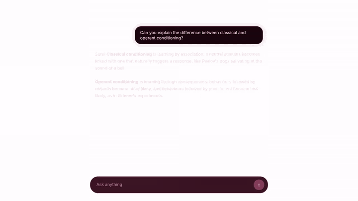
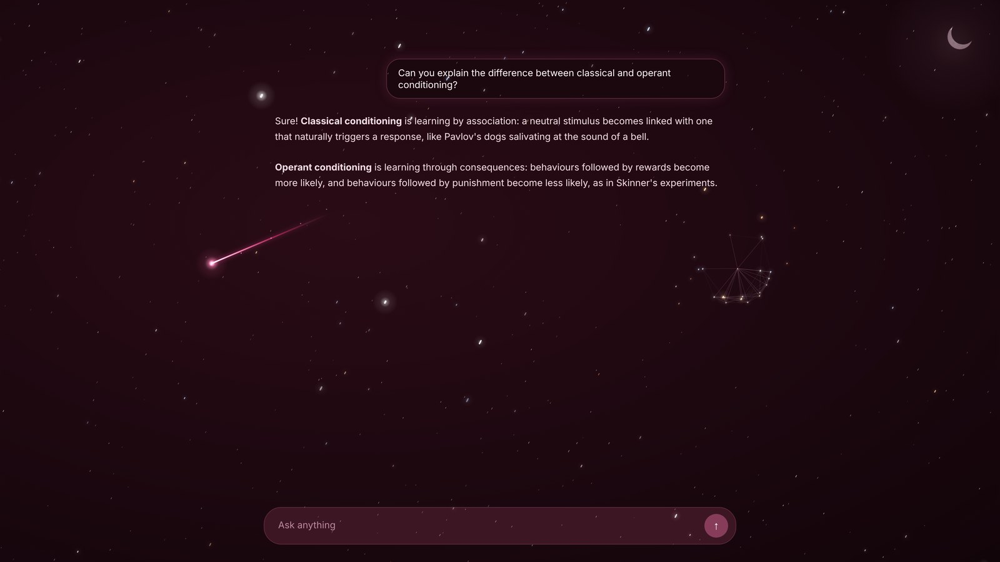
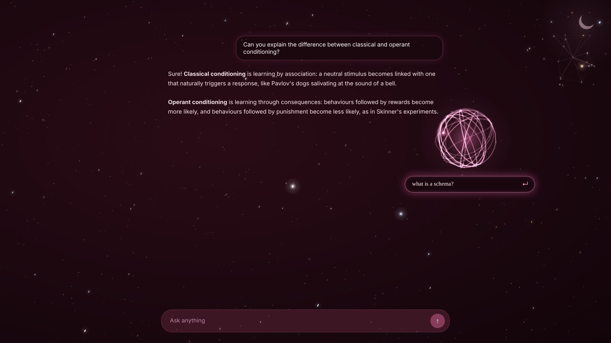
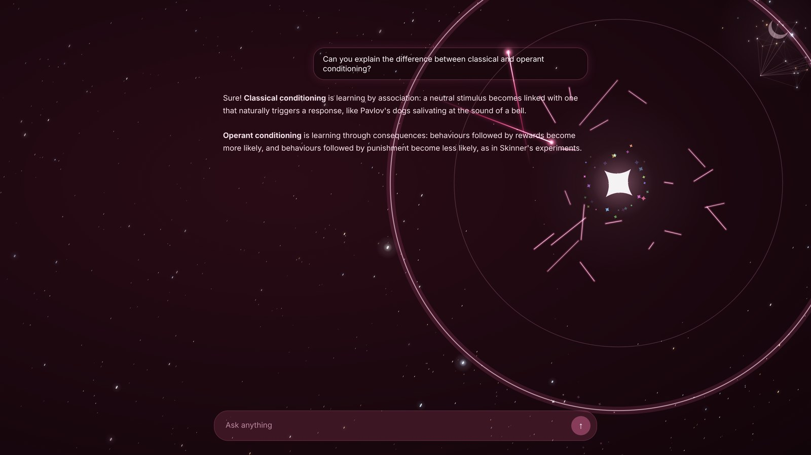
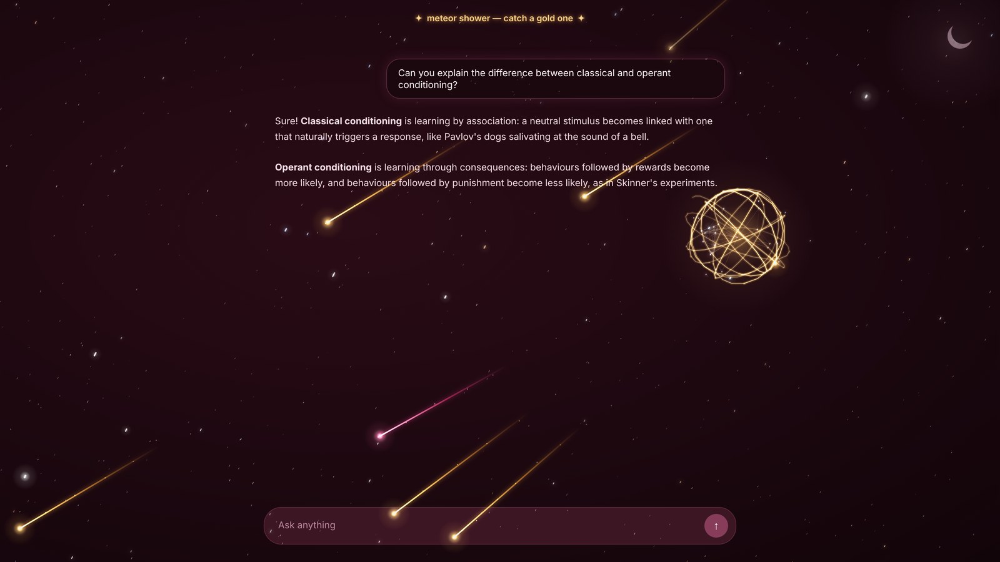
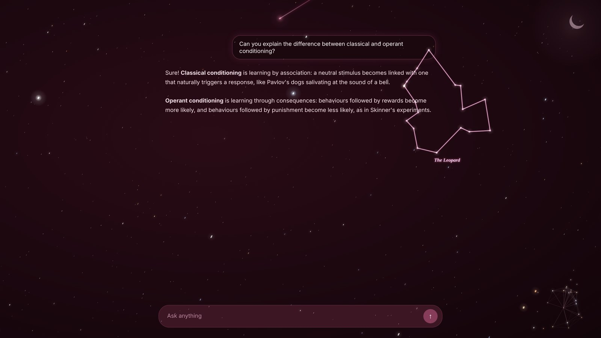
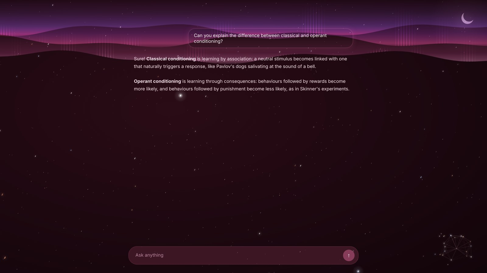
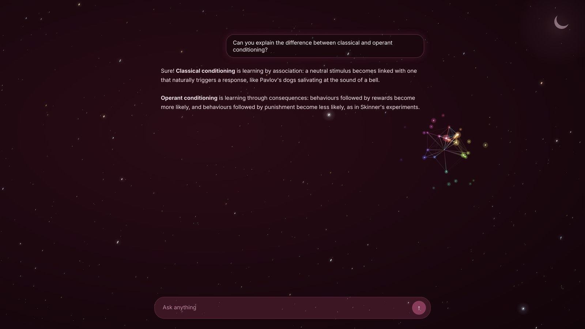
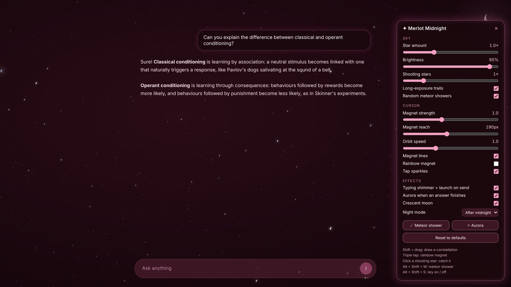

# 🍷 Merlot Midnight

A burgundy night sky for ChatGPT. It's a Tampermonkey userscript that turns ChatGPT's dark mode deep merlot and fills the page with a living star field you can play with.

## ✨ Features

- **Burgundy theme**: deep merlot panels, black-cherry message bubbles, and pink-and-burgundy accents in place of ChatGPT's blue.
- **Photo-style night sky**: dense tiny stars in white, icy blue, amber and orange, with soft long-exposure trails and a few bright "hero" stars.
- **Magnetic cursor**: stars near your cursor gather into a glowing ring, orbit it, follow you around, and spring back when you leave. Faint constellation lines link them together.
- **Neon shooting stars**: pink-white streaks that shed sparkles as they fly, plus a rainbow shooting star every 5 minutes.
- **Sparkle taps**: click anywhere for a 4-point star flare and a burst of glitter that pushes the stars outward.
- **Rainbow mode**: triple-tap to turn the magnet ring into a spinning rainbow. Triple-tap again to switch back.
- **Catch a star**: shooting stars slow down near your cursor. Click one to catch it, and it whips into a glowing ball of light.
- **Ask through the orb**: click the orb, type a question, and press Enter. It's sent to ChatGPT and the orb blows up in a shockwave that ripples through the whole sky. Click anywhere else to detonate it instead.
- **Meteor showers**: about once an hour (or on demand), around 30 gold meteors stream across the sky. Catch one for a **gold orb**.
- **Constellations**: hold Shift and drag across stars to join them with glowing lines, then give your constellation a name.
- **Typing shimmer**: every key you type sends a ripple through nearby stars, and sending a message launches a shooting star from the send button.
- **Aurora**: when ChatGPT finishes an answer, a pink-and-violet aurora ripples across the top of the screen.
- **Crescent moon**: crosses the sky from 6pm to 6am, following your real clock, and rests in the corner during the day.
- **Night mode**: after midnight the sky dims and slows down so it's easy on your eyes, then brightens again in the morning.
- **Settings panel**: press `Alt + Shift + M` to tweak everything with sliders and switches. Your choices are remembered.

## 📸 Gallery

| | |
| --- | --- |
|  |  |
| **The night sky** | **Ask through the orb** |
|  |  |
| **The blast** | **Meteor shower and a gold orb** |
|  |  |
| **Draw your own constellations** | **Aurora when an answer finishes** |
|  |  |
| **Rainbow magnet** | **Settings panel** |

## 📥 Install

1. Install the [Tampermonkey](https://www.tampermonkey.net/) extension in your browser.
2. **Chrome users:** open `chrome://extensions`, turn on **Developer mode** (top right), then open Tampermonkey's **Details** and switch on **Allow User Scripts**. New Chrome versions won't run userscripts without this.
3. Install Merlot Midnight from **[Greasy Fork](https://greasyfork.org/en/scripts/603938-merlot-midnight)** (recommended), or [straight from GitHub](https://raw.githubusercontent.com/ColdSpyy/merlot-midnight/main/merlot-midnight.user.js). Then press **Install** on the Tampermonkey page.
4. Open [ChatGPT](https://chatgpt.com) in **dark mode** and refresh. A shooting star should appear within a couple of seconds.

Tampermonkey checks for updates automatically, wherever you installed it from.

> Had the older "AMAN Burgundy Night Sky" script installed? Delete it from the Tampermonkey dashboard first so the two don't overlap.

## 🎮 Controls

| Action | What happens |
| --- | --- |
| Move your mouse | Stars gather and orbit your cursor |
| Click | Sparkle burst and shockwave |
| Triple-click | Rainbow magnet mode on/off |
| Click a shooting star | Catch it and spin it into an orb |
| Click the orb | Ask a question through it |
| Click away from the orb | Detonate it |
| `Shift` + drag across stars | Draw a constellation (drag back to the first star to close it) |
| Type in the message box | Stars shimmer; Enter launches a shooting star |
| `Alt + Shift + M` | Open the settings panel (`Esc` closes it) |
| `Alt + Shift + W` | Start a meteor shower |
| `Alt + Shift + S` | Force the sky on/off |

In the browser console (F12): `merlotShoot()` launches a shooting star, `merlotRainbow()` a rainbow one, and `merlot.shower()`, `merlot.aurora()` and `merlot.settings()` trigger the other effects.

## ⚙️ Settings

The easiest way is the settings panel: press `Alt + Shift + M` on ChatGPT. It covers star amount, brightness, shooting-star frequency, magnet strength, reach and orbit speed, and switches for every effect, plus night mode (after midnight / always / off).

For deeper changes, edit the `CFG` block at the top of the script (Tampermonkey dashboard → Merlot Midnight):

| Setting | Default | What it does |
| --- | --- | --- |
| `density` | `2600` | Pixels² per star. Smaller = more stars |
| `mouseMode` | `'magnet'` | `'magnet'` to gather stars, `'repel'` to push them away |
| `mouseRadius` | `190` | How far the cursor reaches |
| `mouseStrength` | `1` | `0.5` = gentle, `2` = strong |
| `swirl` | `1` | Orbit speed around the cursor (`0` = no orbit) |
| `magnetLines` | `true` | Constellation lines around the cursor |
| `clickBurst` | `true` | Sparkle burst on click |
| `shootingEveryMs` | `[6000, 14000]` | Random gap between shooting stars |
| `rainbowEveryMs` | `300000` | How often a rainbow shooting star appears |
| `onlyInDark` | `true` | Hide the sky in light mode |
| `nightMode` | `'auto'` | `'auto'` dims after midnight, `'always'`, or `'off'` |
| `showers` | `true` | Random meteor showers, about once an hour |

## 💡 Tips

- If it lags on a big screen, lower **Star amount** in the settings panel.
- If the sky doesn't show, check that ChatGPT is in dark mode, or press `Alt + Shift + S`.
- People who have "reduce motion" turned on get a still sky with no shooting stars.

## 📄 Licence

Merlot Midnight is free software under the [GNU General Public License v3.0](LICENSE).

---

Made by [ColdSpyy](https://github.com/ColdSpyy) 🌙
